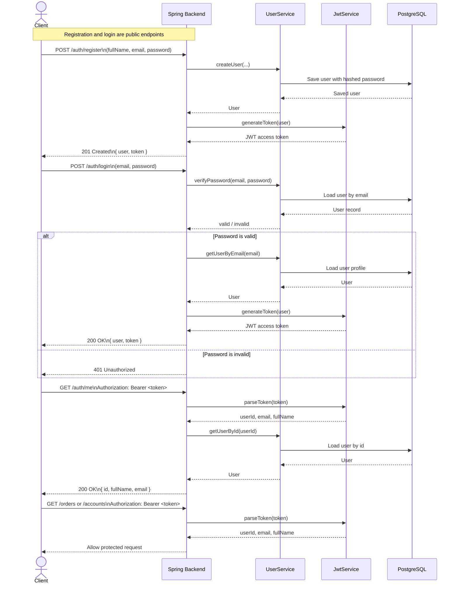

# Auth Sequence Diagram

This diagram shows the current single-backend auth flow. Spring owns the user record, JWT issuance, and JWT validation.

## Flow Summary

1. `POST /auth/register` creates a new user in PostgreSQL, hashes the password, and returns a JWT.
2. `POST /auth/login` checks the password, then returns a new JWT when credentials are valid.
3. `GET /auth/me` reads the bearer token, resolves the user id, and returns the current user profile.
4. Protected routes like `/orders` and `/accounts` require `Authorization: Bearer <token>`.

## Diagram

